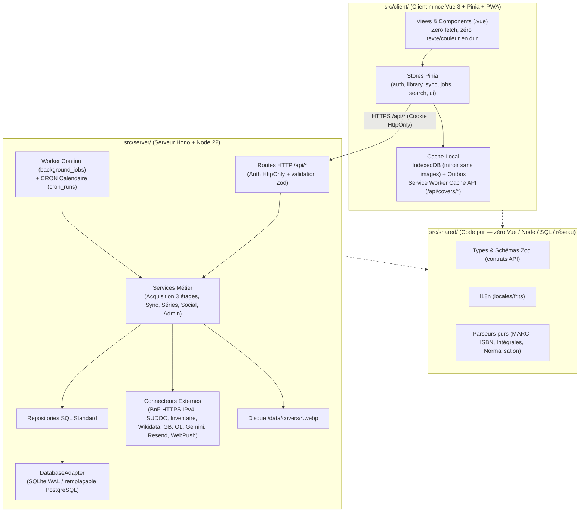
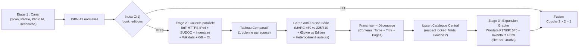
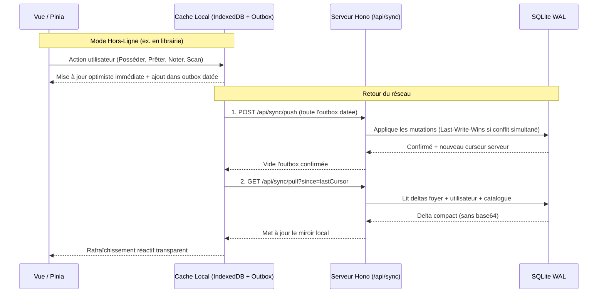

# Blueprint d’Architecture Technique V2 (`biblio-collection`)

> **Rôle de ce document :** Plan d’architecte de référence avant écriture de la première ligne de code V2. Il fige l’arborescence des dossiers, les frontières strictes entre couches (**KISS / SOLID / DRY**), le schéma SQLite V2 complet, le contrat API unique (`/api/*`) et les mécanismes des 4 moteurs clés.
>
> **Documents liés :**
> * [`01_CARTOGRAPHIE_V1.md`](./01_CARTOGRAPHIE_V1.md) — État des lieux V1 et dettes à ne pas reproduire.
> * [`02_PRINCIPES_ARCHITECTURE_V2.md`](./02_PRINCIPES_ARCHITECTURE_V2.md) — Arbitrages CEO/CTO et règles métier.
> * [`03_MATRICE_BIJECTION_V1_V2.md`](./03_MATRICE_BIJECTION_V1_V2.md) — Matrice exhaustive des 52 fonctionnalités à couvrir.
> * [`05_PLAN_EXECUTION_V2.md`](./05_PLAN_EXECUTION_V2.md) — Feuille de route par jalons.

---

## 1. Architecture Globale & Frontières Étanche (`shared` / `server` / `client`)



### Règles de dépendance strictes (anti-spaghetti)
1. **`src/shared/`** ne dépend **de rien** (ni `vue`, ni `node:*`, ni `fetch`, ni `better-sqlite3`).
2. **`src/server/routes/`** valide la session + le payload Zod, appelle un `Service`, et renvoie du JSON typé. **Zéro SQL et zéro logique métier dans une route.**
3. **`src/server/services/`** porte toute la logique métier et orchestre les `Repositories` et `Connectors`. **Zéro requête SQL brute dans un service.**
4. **`src/server/repositories/`** exécute uniquement des requêtes **SQL standard** via `DatabaseAdapter`. **Zéro logique métier complexe ni appel HTTP dans un repository.**
5. **`src/client/views/`** et **`src/client/components/`** n’appellent **jamais `fetch()` ni SQL/IndexedDB directement** : elles lisent/mutent exclusivement via les **Stores Pinia**.
6. **Zéro dépendance circulaire** entre modules (vérifiable par lint/graphique d’imports).

---

## 2. Arborescence Complète des Fichiers V2

```text
inventaire-surcouche/
├── migrations/                          # Migrations SQLite V2 incrémentales (jamais modifiées après coup)
│   └── 0001_v2_initial.sql
├── src/
│   ├── shared/                          # [COUCHE PARTAGÉE PURE]
│   │   ├── locales/
│   │   │   ├── fr.ts                    # 100 % des textes UI (source typée)
│   │   │   └── index.ts                 # Helper t('key', params) + type LocaleKey
│   │   ├── schemas/                     # Contrats Zod partagés Front ↔ Back
│   │   │   ├── auth.schema.ts
│   │   │   ├── book.schema.ts
│   │   │   ├── library.schema.ts
│   │   │   ├── series.schema.ts
│   │   │   ├── social.schema.ts
│   │   │   ├── jobs.schema.ts
│   │   │   ├── sync.schema.ts
│   │   │   └── admin.schema.ts
│   │   ├── bibliographic/               # Algorithmes purs testés
│   │   │   ├── isbn.util.ts             # Validation/normalisation ISBN-10/13 + presse 330/378/977
│   │   │   ├── text-normalize.util.ts   # Clés normalisées, tri sans articles, Levenshtein
│   │   │   ├── intermarc-parser.ts      # Parseur unique InterMarc (BnF) + UNIMARC (SUDOC, filtre 100$a)
│   │   │   ├── integral.util.ts         # Plages tomes inclus, coverage bidirectionnel
│   │   │   ├── category-classifier.ts   # Classification catégorie/sous-genres (Dewey/sujets)
│   │   │   └── batch-actions.util.ts    # Calcul d'éligibilité actions par lot mixtes
│   │   └── types/
│   │       └── domain.types.ts          # Types métier unifiés (BookView, SeriesView, SyncDelta...)
│   │
│   ├── server/                          # [COUCHE SERVEUR HONO + NODE 22]
│   │   ├── index.ts                     # Bootstrap Hono, headers sécurité/PWA, static dist/, worker & cron
│   │   ├── config.ts                    # Lecture validée des variables .env (ADMIN_EMAIL, JWT_SECRET, etc.)
│   │   ├── db/
│   │   │   ├── database.adapter.ts      # Interface DatabaseAdapter (portable SQLite ↔ PostgreSQL)
│   │   │   ├── sqlite.adapter.ts        # Implémentation better-sqlite3 WAL + transactions + migrations
│   │   │   └── migrator.ts              # Runner incrémental strict (schema_migrations)
│   │   ├── middleware/
│   │   │   ├── auth.middleware.ts       # Cookie HttpOnly strict (requireAuth, requireAdmin) — ZÉRO userUri fallback
│   │   │   └── error.middleware.ts      # Mapping erreurs métier -> HTTP propre + JSON standard
│   │   ├── repositories/                # 1 fichier = 1 agrégat SQL standard
│   │   │   ├── user.repo.ts             # users, sessions, password_reset_tokens, user_default_genres, user_ai_usage
│   │   │   ├── library.repo.ts          # libraries, library_members, library_books (Couche 3)
│   │   │   ├── catalog.repo.ts          # franchises, series, books, book_editions, covers (Couches 1 & 2)
│   │   │   ├── reading.repo.ts          # user_reading_states (scopé user_id)
│   │   │   ├── loan.repo.ts             # loans, borrower_contacts
│   │   │   ├── social.repo.ts           # friend_connections, wishlist_reservations
│   │   │   ├── notification.repo.ts     # user_notification_prefs, user_push_subscriptions, series_release_alerts
│   │   │   ├── job.repo.ts              # background_jobs, external_cache, cron_runs
│   │   │   ├── log.repo.ts              # pipeline_logs
│   │   │   └── admin.repo.ts            # Requêtes SQL d'administration (catalogue maître, vue d'ensemble, comptes, logs)
│   │   ├── connectors/                  # Accès réseau externes isolés et mockables
│   │   │   ├── http-client.ts           # Fetch avec timeout, circuit-breaker par source, throttle & cache
│   │   │   ├── bnf.connector.ts         # BnF SRU HTTPS IPv4 (ISBN, CQL, 460$3 ens2bib)
│   │   │   ├── sudoc.connector.ts       # SUDOC ABES (isbn2ppn + XML UNIMARC)
│   │   │   ├── inventaire.connector.ts  # Inventaire.io (by-uris P629/P179, reverse-claims, search)
│   │   │   ├── wikidata.connector.ts    # Wikidata wbgetentities + SPARQL (P179/P1545)
│   │   │   ├── google-books.connector.ts# Google Books (circuit-breaker 429)
│   │   │   ├── openlibrary.connector.ts # Open Library (ISBN + search)
│   │   │   ├── gemini.connector.ts      # Gemini Vision OCR (clé serveur)
│   │   │   ├── resend.connector.ts      # E-mails (reset password + digests)
│   │   │   └── webpush.connector.ts     # Web Push VAPID ES256 + RFC 8291
│   │   ├── services/                    # Logique métier pure (SOLID)
│   │   │   ├── auth.service.ts          # Inscription RGPD, ADMIN_EMAIL, login, reset, suppression compte + succession owner
│   │   │   ├── cover.service.ts         # Téléchargement, compression WebP, stockage /data/covers/, purge orphelins >30j
│   │   │   ├── acquisition/
│   │   │   │   ├── comparison-table.service.ts  # Étage 2 : Collecte parallèle + Tableau Comparatif + Arbitre
│   │   │   │   ├── collection-guard.service.ts  # Détection algorithmique anti-fausses séries (MARC + Œuvre/Édition + auteurs)
│   │   │   │   ├── series-graph.service.ts      # Étage 3 : Graphe Franchise -> Découpage -> Œuvres (Wikidata/Inventaire > BnF)
│   │   │   │   └── ingestion.service.ts         # Orchestration ISBN -> Catalogue Central -> Liaison Foyer (respect locked_fields)
│   │   │   ├── search.service.ts        # Recherche catalogue exhaustive (local SQLite + BnF + Inventaire -> Séries + Œuvres)
│   │   │   ├── photo-ai.service.ts      # OCR Gemini + quota + Canal 3 + arbitrage serveur + relance BnF tranche
│   │   │   ├── library.service.ts       # Actions Foyer (posséder, wishlist, surcharge Couche 3, reset auto, suppression + prêtés)
│   │   │   ├── loan.service.ts          # Prêts, retours, contacts
│   │   │   ├── reading.service.ts       # Statuts lecture, notes, notes perso (strictement user_id)
│   │   │   ├── sync.service.ts          # Protocole PUSH (outbox) + PULL (delta since)
│   │   │   ├── social.service.ts        # Foyer, Amis, régénération codes, vitrine lecture seule + réservation cadeau anti-spoiler
│   │   │   ├── notification.service.ts  # Préférences, Web Push, détection nouveautés, digests
│   │   │   ├── stats-export.service.ts  # Calcul stats période + Export CSV / JSON
│   │   │   └── admin.service.ts         # Stats globales, édition Catalogue Maître unitaire/lot (Couche 2 locked_fields), logs, quotas
│   │   ├── workers/
│   │   │   ├── background-worker.ts     # Worker continu (dépile background_jobs + enrichissement tomes)
│   │   │   └── cron-scheduler.ts        # CRON calendaire idempotent (cron_runs : digests horaires, veille nocturne, purge)
│   │   └── routes/                      # 1 routeur Hono par domaine, monté sous /api/*
│   │       ├── index.ts                 # Assembleur unique /api/* (exporte AppType pour Hono RPC)
│   │       ├── auth.routes.ts
│   │       ├── profile.routes.ts
│   │       ├── sync.routes.ts
│   │       ├── books.routes.ts
│   │       ├── series.routes.ts
│   │       ├── library.routes.ts
│   │       ├── loans.routes.ts
│   │       ├── jobs.routes.ts
│   │       ├── search.routes.ts
│   │       ├── covers.routes.ts
│   │       ├── social.routes.ts
│   │       ├── notifications.routes.ts
│   │       ├── stats.routes.ts
│   │       └── admin.routes.ts
│   │
│   └── client/                          # [COUCHE CLIENT MINCE VUE 3 + PINIA + PWA]
│       ├── main.ts                      # Pinia, Router, PWA, directive globale auto-select focus, thème initial
│       ├── App.vue                      # App Shell, bandeaux globaux (offline, jobs serveur), <ToastHost>, <CameraModal>
│       ├── router/
│       │   └── index.ts                 # Routes propres (zéro vue morte/orpheline)
│       ├── api/
│       │   └── client.ts                # Client typé Hono RPC + gestion globale 401 / offline
│       ├── cache/
│       │   ├── indexeddb.ts             # Dexie minimaliste : mirror_books, mirror_series, mirror_loans, mirror_reading, outbox
│       │   └── sync-engine.ts           # Moteur unique : PUSH outbox d'abord -> PULL delta ensuite
│       ├── stores/                      # Vrais stores Pinia (composition API)
│       │   ├── auth.store.ts            # Session, profil, thème, genres défaut, déconnexion
│       │   ├── library.store.ts         # Collection, Wishlist, Prêts, Séries (lecture cache + actions)
│       │   ├── jobs.store.ts            # Abonnement global SSE/polling aux background_jobs serveur (Photo IA, séries)
│       │   ├── scan.store.ts            # Caméra, mode simple/rafale, recherche textuelle persistante
│       │   ├── social.store.ts          # Foyer, Amis, vitrine publique & réservations cadeaux
│       │   └── ui.store.ts              # Toasts globaux, pile modales, état online/offline, états vues (pagination/scroll)
│       ├── styles/                      # Design System 100 % Design Tokens
│       │   ├── tokens.css               # [data-theme="editorial-light"], [data-theme="dark"], [data-theme="warm"]
│       │   ├── base.css                 # Reset, typographie, accessibilité focus
│       │   ├── primitives.css           # .btn, .input, .badge, .card, .panel, .tabs
│       │   └── layouts.css              # Grilles responsives, tab bar mobile, header desktop
│       ├── components/
│       │   ├── base/                    # Socle unique réutilisable
│       │   │   ├── BaseModal.vue        # Modale unique (pile z-index, Escape, backdrop, scroll lock)
│       │   │   ├── ToastHost.vue        # Notifications non intrusives globales
│       │   │   ├── AppHeader.vue        # Nav desktop + Tab Bar mobile
│       │   │   ├── PaginationBar.vue
│       │   │   └── QrCodeDisplay.vue
│       │   ├── books/                   # BookCard, SeriesCard, BookActions, BatchActionBar, IntegralFields, CoverPicker
│       │   ├── modals/                  # ConfirmDeleteModal (avec choix par livre prêté), LendModal, SeriesAttachModal, BatchGenreModal, PhotoItemModal, CameraBarcodeModal, NotificationOnboardingModal
│       │   └── social/                  # FamilySharePanel, SharedLibraryBrowser
│       └── views/                       # 15 vues propres (plus de vues mortes)
│           ├── LoginView.vue
│           ├── DashboardView.vue
│           ├── CollectionView.vue
│           ├── WishlistView.vue
│           ├── LoansView.vue
│           ├── ReleasesView.vue
│           ├── ScanView.vue             # 4 onglets (Photo IA, Rafale, Scan simple, Recherche textuelle)
│           ├── BookDetailView.vue
│           ├── BookEditView.vue
│           ├── BookCreateView.vue
│           ├── SeriesDetailView.vue
│           ├── AuthorDetailView.vue
│           ├── SocialView.vue           # Onglets Foyer & Amis
│           ├── PublicShareView.vue      # /shared/:token (amis uniquement)
│           ├── ProfileView.vue          # Onglets Compte/Thème/Export, Statistiques, Genres, Notifications
│           ├── AdminView.vue            # Onglets Stats, Catalogue Maître, Comptes/Maintenance, Logs
│           └── DebugCacheView.vue       # Inspection cache local IndexedDB
```

---

## 3. Schéma SQLite V2 Complet (`migrations/0001_v2_initial.sql`)

Un seul fichier SQLite WAL (`/data/biblio.sqlite`) structuré en **4 espaces logiques étanches** (SQL standard compatible PostgreSQL) :

### Espace 1 — Le Catalogue Central (Serveur — Commun)
| Table | Clé Primaire | Colonnes clés & contraintes | Rôle |
| :--- | :--- | :--- | :--- |
| **`franchises`** | `id` | `canonical_name`, `normalized_key` (UNIQUE), `wikidata_qid`, `created_at`, `updated_at` | Niveau macro d'une saga (ex. *Fables*, *Tintin*). Relie plusieurs découpages éditoriaux entre eux. |
| **`series`** | `id` | `franchise_id` (FK `franchises`), `canonical_name`, `normalized_key`, `edition_signature` (UNIQUE avec `normalized_key`), `aliases_json`, `primary_authors_json`, `wikidata_qid`, `bnf_ensemble_ids_json`, `is_complete_expanded`, `known_volumes_count`, `locked_fields_json`, `last_checked_at`, `created_at`, `updated_at` | Découpage éditorial / lignée cohérente (ex. *Fables Classique 22 t.* vs *Fables Nomad 10 t.*). |
| **`books`** | `id` | `work_canonical_id` (UNIQUE), `series_id` (FK `series`), `title`, `normalized_title`, `volume_number`, `volume_label`, `sort_order`, `is_hors_serie`, `is_integral`, `included_volumes_json`, `authors_json`, `scriptwriters_json`, `illustrators_json`, `publisher`, `collection_name`, `publish_year`, `page_count`, `description`, `language`, `main_category`, `subgenres_json`, `cover_key` (FK `covers`), `wikidata_qid`, `inventaire_uri`, `source_origin` (`auto`\|`manual`), `locked_fields_json` (Couche 2 Admin), `created_at`, `updated_at` | Fiche œuvre consolidée du Catalogue Central. |
| **`book_editions`** | `isbn13` | `book_id` (FK `books` ON DELETE CASCADE), `publisher`, `collection_name`, `publish_year`, `page_count`, `cover_key` (FK `covers`), `source`, `created_at` | Index O(1) de tous les ISBN-13 FR sœurs vers `books.id` + catalogue propre des éditions physiques. |
| **`covers`** | `cover_key` | `file_path`, `source_url`, `mime_type`, `byte_size`, `sha256`, `created_at`, `last_referenced_at` | Métadonnées des fichiers WebP sur `/data/covers/`. **Zéro blob binaire dans SQLite.** |

### Espace 2 — L’Espace Foyer (`library_id`, Privé partagé par foyer)
| Table | Clé Primaire | Colonnes clés & contraintes | Rôle |
| :--- | :--- | :--- | :--- |
| **`libraries`** | `id` | `name`, `owner_user_id` (FK `users`), `family_invite_code` (UNIQUE), `friend_share_token` (UNIQUE), `created_at`, `updated_at` | Foyer familial + codes d'invitation Foyer et partage Amis (régénérables). |
| **`library_members`** | `(library_id, user_id)` | `role` (`owner`\|`member`), `joined_at` | Membres du foyer. Si `owner` quitte/supprime son compte, promotion auto du plus ancien `member`. |
| **`library_books`** | `(library_id, book_id)` | `status` (`owned`\|`wish`\|`none`), `wished_by_user_id` (FK `users`), `overrides_json` (Couche 3 : `title`, `authors`, `series_id`, `volume_label`, `sort_order`, `is_hors_serie`, `is_integral`, `included_volumes`, `genres`, `cover_key`, `hidden_series_ids`, `one_shot_forced`), `overrides_updated_at`, `added_at`, `updated_at`, `deleted_at` | Possession, wishlist et **surcharges privées verrouillées (Couche 3)** par foyer. |
| **`loans`** | `id` | `library_id` (FK `libraries`), `book_id` (FK `books`), `borrower_name`, `loaned_at`, `returned_at`, `notes`, `updated_at` | Carnet de prêts actifs (`returned_at IS NULL`) et historique du foyer. |
| **`borrower_contacts`** | `(library_id, name)` | `last_used_at` | Autocomplétion des emprunteurs du foyer. |
| **`series_release_alerts`** | `id` | `library_id` (FK `libraries`), `series_id` (FK `series`), `book_id` (FK `books`), `detected_at`, `dismissed_at`, UNIQUE `(library_id, book_id)` | Alertes nouveautés par foyer. |
| **`wishlist_reservations`** | `(library_id, book_id)` | `reserved_by_user_id` (FK `users`), `reserved_at` | Réservation cadeau par un ami (*« Je l'offre »*). **Strictement filtrée côté API pour les membres de `library_id`**, purgée automatiquement dès `library_books.status = 'owned'`. |

### Espace 3 — L’Espace Compte / Utilisateur (`user_id`, Strictement individuel)
| Table | Clé Primaire | Colonnes clés & contraintes | Rôle |
| :--- | :--- | :--- | :--- |
| **`users`** | `id` | `username` (UNIQUE), `email` (UNIQUE), `password_hash`, `is_admin`, `theme`, `locale`, `gdpr_accepted_at`, `onboarding_notif_seen`, `created_at`, `updated_at` | Compte utilisateur, thème visuel choisi, langue, consentement RGPD. |
| **`sessions`** | `token_hash` | `user_id` (FK `users` ON DELETE CASCADE), `expires_at`, `created_at` | Sessions cookie `HttpOnly` strictes. |
| **`password_reset_tokens`** | `token_hash` | `user_id` (FK `users` ON DELETE CASCADE), `expires_at`, `used_at` | Codes à 6 chiffres de récupération mot de passe (e-mail Resend). |
| **`user_reading_states`** | `(user_id, book_id)` | `status` (`none`\|`to_read`\|`reading`\|`read`\|`abandoned`), `rating` (`0..5`), `notes`, `updated_at` | Lecture, note et notes personnelles **strictement individuelles par utilisateur**. |
| **`user_default_genres`** | `(user_id, genre_label)` | `created_at` | Liste personnalisée des genres par défaut de l'utilisateur. |
| **`friend_connections`** | `(user_id, target_library_id)` | `created_at` | Bibliothèques d'amis suivies par l'utilisateur. |
| **`user_notification_prefs`** | `user_id` | `frequency` (`off`\|`daily`\|`weekly`\|`monthly`), `day_of_week`, `day_of_month`, `hour`, `timezone`, `channel` (`push`\|`email`\|`both`), `last_notified_at`, `updated_at` | Réglages digests nouveautés. |
| **`user_push_subscriptions`** | `id` | `user_id` (FK `users` ON DELETE CASCADE), `endpoint` (UNIQUE), `p256dh`, `auth`, `created_at` | Abonnements Web Push VAPID. |
| **`user_ai_usage`** | `user_id` | `month_key`, `month_used`, `total_used`, `updated_at` | Suivi du quota mensuel Photo IA Gemini. |

### Espace 4 — Technique, Jobs & Observabilité
| Table | Clé Primaire | Colonnes clés & contraintes | Rôle |
| :--- | :--- | :--- | :--- |
| **`background_jobs`** | `id` | `type` (`photo_ocr`\|`photo_retry_item`\|`series_expand`\|`book_enrich`), `user_id`, `library_id`, `status` (`pending`\|`running`\|`done`\|`error`), `progress_done`, `progress_total`, `payload_json`, `result_json`, `error_message`, `attempts`, `created_at`, `updated_at` | Moteur unique de tâches longues 100 % serveur (survit à la fermeture et multi-appareils). |
| **`external_cache`** | `cache_key` | `source`, `response_json`, `expires_at` | Cache des réponses APIs externes (BnF, SUDOC, Wikidata, Inventaire) pour vitesse et résilience. |
| **`cron_runs`** | `job_name` | `last_run_key`, `last_run_at`, `status`, `summary_json` | Idempotence et rattrapage des tâches calendaires après redémarrage Docker. |
| **`pipeline_logs`** | `id` | `trace_id`, `user_id`, `channel`, `stage`, `step`, `status`, `duration_ms`, `summary`, `payload_json`, `created_at` | Observabilité et diagnostic Admin (purge TTL nocturne). |

---

## 4. Contrat API Unique (`/api/*` — Hono + Zod)

Toutes les routes privées exigent un cookie de session `HttpOnly; Secure; SameSite=Lax` valide (**zéro fallback `userUri`**).

| Domaine | Méthode & Route | Auth | Rôle |
| :--- | :--- | :--- | :--- |
| **Santé** | `GET /api/health` | Public | Santé serveur, mode DB, uptime |
| **Auth** | `POST /api/auth/register` | Public | Inscription + RGPD + `?invite`/`?friend` + auto-admin via `ADMIN_EMAIL` |
| | `POST /api/auth/login` | Public | Connexion + pose cookie `HttpOnly` |
| | `POST /api/auth/logout` | Privé | Révocation session + suppression cookie |
| | `POST /api/auth/forgot-password` | Public | Envoi code 6 chiffres par e-mail (Resend) |
| | `POST /api/auth/reset-password` | Public | Validation code + nouveau mot de passe |
| **Profil** | `GET /api/me` | Privé | Profil, foyer, membres, thème, genres défaut, quota IA, alertes non lues |
| | `PATCH /api/me` | Privé | Modifier pseudo, e-mail, mot de passe, thème, locale, `onboarding_notif_seen` |
| | `DELETE /api/me` | Privé | Suppression compte (mot de passe requis, succession `owner` si foyer partagé, catalogue intact) |
| | `PUT /api/me/genres` | Privé | Ajouter / retirer / réinitialiser genres par défaut (`user_default_genres`) |
| | `GET /api/me/export?format=csv\|json` | Privé | Export complet de la bibliothèque + statuts de lecture |
| **Sync** | `POST /api/sync/push` | Privé | **Étape 1 reconnexion** : applique l'`outbox` offline datée (possessions, prêts, lectures) |
| | `GET /api/sync/pull?since=...` | Privé | **Étape 2 reconnexion** : delta des livres, séries, prêts, lectures et suppressions |
| **Acquisition** | `POST /api/books/resolve-isbn` | Privé | Pipeline 3 étages : ISBN → Tableau Comparatif → Graphe (mode `preview`, `owned` ou `wish`) |
| | `POST /api/books/manual` | Privé | Création manuelle d'un livre inconnu (`source_origin = 'manual'`) + expansion série optionnelle |
| | `POST /api/search/catalog` | Privé | Recherche multi-critères exhaustive (local SQLite + BnF + Inventaire → `{ series[], books[] }`) |
| **Livres** | `GET /api/books/:bookId` | Privé | Fiche fusionnée (`Couche 3 > Couche 2 > Couche 1`) + contexte série + état lecture individuel |
| | `PATCH /api/library/books/:bookId` | Privé | Enregistre les surcharges Couche 3 (titre, auteurs, série, intégrale, couverture, genres, one-shot) |
| | `DELETE /api/library/books/:bookId/overrides` | Privé | Réinitialise la fiche avec les données automatiques (lève le verrou Couche 3) |
| | `POST /api/library/books/batch-status` | Privé | Passer un lot en `owned` / `wish` / `none` (gère confirmation et choix individuel livres prêtés) |
| | `POST /api/library/books/batch-genres` | Privé | Ajout cumulatif de genres (Couche 3) sur une sélection |
| | `GET /api/books/:bookId/covers` | Privé | Galerie d'alternatives de couvertures dédupliquées (éditions sœurs + sources externes) |
| **Couvertures** | `GET /api/covers/:coverKey` | Public* | Sert le fichier WebP depuis `/data/covers/` (`Cache-Control: immutable`, mis en cache par SW PWA) |
| | `POST /api/covers/upload` | Privé | Upload / compression WebP d'une couverture personnalisée → retourne `coverKey` |
| **Lecture** | `PUT /api/reading/:bookId` | Privé | Statut (`none`..`abandoned`), note (`0..5`), notes perso (**strictement `user_id`**) |
| **Séries** | `GET /api/series/:seriesId` | Privé | Tomes du découpage + autres découpages de la même Franchise |
| | `POST /api/series/:seriesId/expand` | Privé | Enrichissement immédiat (Graphe Wikidata/Inventaire → BnF `460$3` → SUDOC) + bilan réel |
| | `POST /api/series/attach` | Privé | Rattacher / fusionner un ou plusieurs livres (ou toute une série) dans une série cible (Couche 3) |
| | `POST /api/series/:seriesId/exclude` | Privé | Exclure un ou plusieurs tomes d'une série pour ce foyer (`hidden_series_ids`, Couche 3) |
| **Auteurs** | `GET /api/authors/:name` | Privé | Séries et œuvres locales + catalogue serveur de l'auteur |
| **Prêts** | `GET /api/loans` | Privé | Prêts actifs + contacts emprunteurs + amis suivis |
| | `POST /api/loans` | Privé | Prêter un ou plusieurs livres à un emprunteur |
| | `POST /api/loans/return` | Privé | Marquer un ou plusieurs prêts comme rendus |
| **Jobs / Photo IA** | `GET /api/jobs` | Privé | Liste des jobs actifs/récents de l'utilisateur (Photo IA, enrichissements) |
| | `GET /api/jobs/stream` | Privé | Flux SSE (Server-Sent Events) temps réel d'avancement des jobs |
| | `POST /api/jobs/photo` | Privé | Crée un job Photo IA (étagère/couverture) : OCR Gemini + Canal 3 sur serveur |
| | `PATCH /api/jobs/photo/:jobId/items/:itemId` | Privé | Persiste l'arbitrage utilisateur (sélection, édition choisie, intégrale, ignoré) sur le serveur |
| | `POST /api/jobs/photo/:jobId/items/:itemId/retry-bnf` | Privé | Relance BnF ciblée **côté serveur** et met à jour `result_json` |
| | `POST /api/jobs/photo/:jobId/retry-failed` | Privé | Relance les items/jobs en erreur |
| | `POST /api/jobs/photo/:jobId/commit` | Privé | Valide les items cochés du lot vers la Collection ou la Wishlist |
| | `DELETE /api/jobs/photo/:jobId` | Privé | Supprime / vide un lot Photo IA terminé |
| **Nouveautés & Notifs** | `GET /api/releases` | Privé | Alertes de sorties du foyer |
| | `POST /api/releases/check` | Privé | Déclenche une vérification des séries suivies |
| | `POST /api/releases/dismiss` | Privé | Acquitte une ou toutes les alertes |
| | `GET / PUT /api/notifications/prefs` | Privé | Fréquence, jour, heure, fuseau, canal |
| | `POST / DELETE /api/notifications/push` | Privé | Souscription / désinscription Web Push VAPID |
| **Social** | `POST /api/social/family/join` | Privé | Rejoindre un foyer via code `FAM-...` |
| | `POST /api/social/tokens/regenerate` | Privé | Régénérer le code Foyer ou le code Amis (révocation de l'ancien lien) |
| | `GET / POST / DELETE /api/social/friends` | Privé | Lister / ajouter (par `PUB-...`) / retirer un ami |
| | `GET /api/social/share/:token` | Public (jeton secret) | Vitrine lecture seule (Collection, Wishlist, Prêtés sans nom d'emprunteur ; statut réservations visible **hors foyer propriétaire**) |
| | `POST / DELETE /api/social/share/:token/reserve/:bookId` | Privé (ami hors foyer) | Réserver / annuler un cadeau (*« Je l'offre »*) sur la wishlist d'un ami |
| **Statistiques** | `GET /api/stats?periodDays=...` | Privé | KPIs foyer + stats lecture individuelles + Tops cliquables |
| **Admin** | `GET /api/admin/overview` | Admin | Vue globale plateforme (comptes, catalogue, quotas, couvertures, alertes) |
| | `GET / PATCH /api/admin/catalog` | Admin | Liste paginée/filtrée + édition unitaire/lot Catalogue Maître (inscrit `locked_fields` Couche 2) |
| | `GET /api/admin/users` + `POST /api/admin/users/:id/reset-ai-quota` | Admin | Gestion comptes et RAZ quota IA |
| | `POST /api/admin/maintenance/:task` | Admin | Déclenchement manuel veille nouveautés / éditions sœurs / purge orphelins |
| | `GET / DELETE /api/admin/logs` | Admin | Consultation, filtrage, export JSON et purge TTL des `pipeline_logs` |

---

## 5. Conception des 4 Moteurs Clés

### Moteur 1 — Pipeline d'Acquisition 3 Étages & Primauté (`Couche 3 > 2 > 1`)


### Moteur 2 — Synchronisation Hors-Ligne (`PUSH d'abord, PULL ensuite`)


### Moteur 3 — Worker Continu & CRON Calendaire
* **Worker continu (`background-worker.ts`) :** réveillé dès qu'un job entre dans `background_jobs` (Photo IA, relance BnF, expansion série, enrichissement d'un tome du graphe). Limiteur de concurrence et throttle BnF/Wikidata propres ; redémarrage automatique des jobs `running` interrompus au boot du serveur.
* **CRON calendaire (`cron-scheduler.ts`) :** vérifie chaque minute la table `cron_runs` :
  * *Horaire (`YYYY-MM-DDTHH`)* : `runHourlyDigestDispatch` (Web Push VAPID + Resend selon fuseau horaire).
  * *Nocturne (`YYYY-MM-DD`, à partir de `02h00`, rattrapé au boot si manqué)* : veille nouveautés séries, découverte éditions sœurs, purge logs TTL, purge fichiers `/data/covers/` orphelins > 30 jours.

### Moteur 4 — Design Tokens Multi-Thèmes & `i18n`
* **CSS :** 0 couleur hex/rgb dans les fichiers `.vue`. Tous les thèmes (`editorial-light`, `dark`, `warm`) définissent exactement les mêmes variables CSS dans `src/client/styles/tokens.css` (`--bg-page`, `--bg-surface`, `--bg-elevated`, `--text-primary`, `--text-muted`, `--border-subtle`, `--accent`, `--accent-contrast`, `--status-owned`, `--status-wish`, `--status-lent`, `--status-integral`, `--danger`, `--radius-*`, `--font-heading`, `--font-body`).
* **`i18n` :** fonction `t('section.key', { count })` typée sur `src/shared/locales/fr.ts`. Toute clé manquante est détectée par `tsc` à la compilation.
